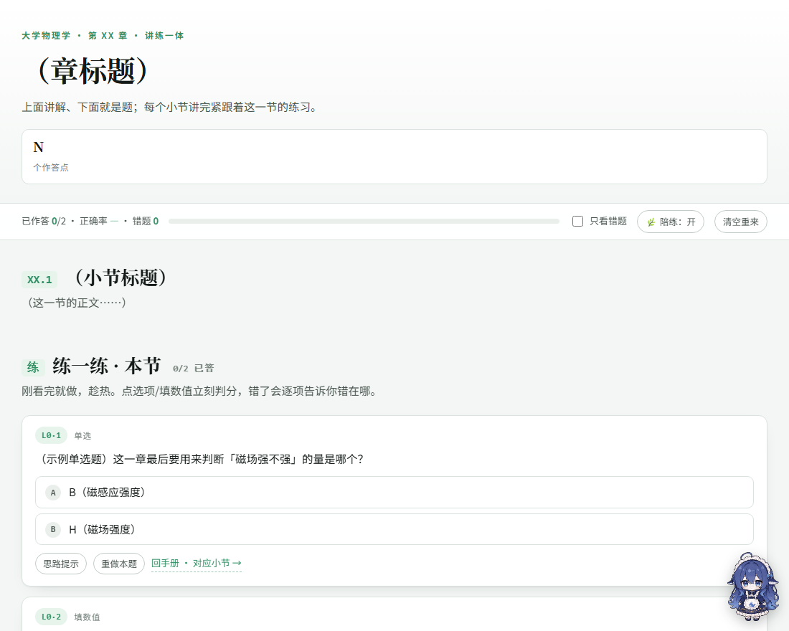
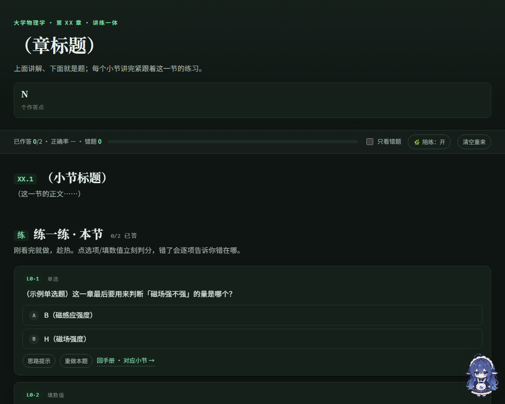

# 讲练一体 · interactive-study-guide

把一章课件（PPT / PDF）或教材，做成**一个本地 HTML 文件**的学习材料：讲解与小节练习紧挨着，
点选项立刻判分并逐项说明错在哪；关键概念配可拖滑块的演示；进度自动保存在本地。

面向 [Claude Code](https://claude.com/claude-code) 的 Skill——装好之后，说一句
「把第 14 章做成讲练一体的 HTML」即可。





> 上面是内置的骨架示例页实拍：深浅两套配色、吸顶进度条、题卡与右下角陪练。
> 右下角那份形象是内置的「大肥鱼」（第三方素材，MIT，见下文）。

---

## 特性

- **单页长文档**：讲解与练习在同一页，向下滚动即可，不切页、不分文件。
  切页会重置滚动位置（看到后面去做题再回来就找不着北），因此刻意不做标签页。
- **讲—练紧邻**：一个知识块讲完，紧接着就是它的 2–4 道题；题区标题带「已答 / 总数」。
- **即时反馈**：点选项或填数值立刻判定；正确项着绿、选错的那项着红，并逐项写出「它错在哪」。
  另有「思路提示」（只给方向）、「重做本题」；解析默认收起、答题后展开。
- **综合大题**：拆成「一步一问」，每小步单独判分，放在全章末尾，之后是「学习结算」与薄弱关卡诊断。
- **进度自动保存**：`已作答 x/N · 正确率 · 错题数` 常驻吸顶条，可切「只看错题」、可「清空重来」。
  每章的存储键独立，互不干扰。
- **可拖演示**：读数与图形都由公式现场算出，图和数永远自洽；刻度也由脚本计算，不写死。
- **数值题容错**：`1.06`、`1.06 T`、`2.51e-4`、`2.51×10⁻⁴`、`1,06`、全角数字 `１５`、印刷体负号 `−5` 都认；
  写算式（`5-3`、`1/2`）会被明确告知「只认一个数字」，而不是含糊地判错。
- **题库字段校验**：写错字段的题会被标红跳过并告警，不影响其余题目与页面功能。
- **零外部依赖**：除使用者自备的图片外，页面不请求任何外部资源（无 CDN、无网络字体、无 MathJax）。
- **手机 / 平板可用**：iOS 与 Android 双端适配（安全区、触摸目标 ≥40px、点按无高亮残留、
  不自动放字号）；iPad 上常见的「HTML 查看器」类 App 也已专门适配。

## 环境要求

- 生成端：Claude Code（本 Skill 通过它运行），以及 Python 3（仅用于几个辅助脚本）。
- 使用端：任意现代浏览器（Safari / Chrome / Edge）。**建议在手机或平板上看**——页面就是为此设计的。

## 安装

把 `skills/interactive-study-guide/` 整个目录放到下面任一处，即会被自动识别：

```bash
# ① 只给某个项目用（推荐）
<你的项目>/.claude/skills/interactive-study-guide/

# ② 给这台机器上所有项目用
~/.claude/skills/interactive-study-guide/          # Windows: C:\Users\<你>\.claude\skills\
```

## 使用流程

1. **备内容**：把课件（PPT）导出成 PDF 或文本，或直接使用手头的教材 / 拆解笔记。
   从 PDF 抽文本后**先回读校对**：CJK 可能缺字形、公式常被排成图片、多栏版式会串行。
2. **切单元**：一章切成 5–7 个单元（概念 / 核心推导 / 例题习题 / 专题 / 综合），
   每个单元 = 讲解块 + 紧跟其后的题区。给每级题区分配一个 `lv`（0…n），综合大题用最大编号。
3. **写题库**：若干 `<script data-bank type="application/json">` 块，一段一个单元；字段见
   [`references/quiz-engine.md`](skills/interactive-study-guide/references/quiz-engine.md)。
   建议用 Python `json.dumps(ensure_ascii=False)` 生成并 `json.loads` 回读校验，别手写转义。
4. **写演示（2–3 个）**：挑「最容易想歪、最适合用拖拽建立直觉」的量；读数与曲线都由公式现算现画。
5. **拼页面**：复制
   [`assets/page-skeleton.html`](skills/interactive-study-guide/assets/page-skeleton.html) 起步
   （引擎与样式已内联，交付就是一个文件）；把讲解换成这一章的小节，把题区插到各单元末尾。
6. **校验（不要跳过）**：注入探针、无头浏览器跑一遍、逐项核对、截图看浅色 / 深色。
   页面「看起来对」不算数——详见下文「校验体系」。

## 目录结构

```
skills/interactive-study-guide/
├── SKILL.md                     # 给模型看的说明书：形态铁律、工作流程、最致命的坑
├── assets/
│   ├── page-skeleton.html       # ★ 最小可跑骨架（引擎 + 样式已内联）——新章从这里复制
│   ├── quiz-engine.js           # 通用引擎：渲染 / 判分 / 反馈 / 统计 / 存盘 / 陪练 / 台词表
│   ├── practice.css             # 样式：深浅色 token、题卡、演示台、陪练、背景层
│   ├── demo-markup.html         # 演示台的标准标记（复制即用，id 约定写在注释里）
│   ├── demos-example.js         # 三个可拖演示的完整写法
│   ├── inject-probe.py          # 探针注入器（安全包好 script 标签 + 拒绝自毁写法）
│   ├── verify-probe.js          # 主探针：自动作答全题库，核对判分 / 统计 / 结算 / 报错
│   ├── pet-probe.js             # 陪练探针：没图不占地方 / 有图能拖能切 / 台词认没认出来
│   ├── demo-probe.js            # 演示探针：滑块 min/mid/max 读数 + SVG 越界
│   ├── merge-interleave.py      # 与既有讲解页合体成单页（改顶部 CFG 即可换章）
│   ├── refresh-assets.py        # 从跑通的页面反抽引擎 / 样式 / 骨架
│   └── sync-skeleton.py         # 资产 → 骨架内联副本的同步器（默认只检查）
├── references/
│   ├── quiz-engine.md           # 题库字段表、判分规则、必备 DOM、题库字段校验
│   ├── pet-guide.md             # 陪练规范：形象来源、交互约定、台词键位表与四种注入方式
│   ├── demo-guide.md            # 演示选材、平面矢量图画法约定、曲线面板防裁切
│   ├── build-and-verify.md      # 合体脚本做法 + 无头校验配方（十一项必查）
│   └── pitfalls.md              # 全部踩过的坑与对策（本项目的知识库）
└── third-party/dafeiyu-pet/     # 内置「大肥鱼」形象的原图 + MIT 许可原文 + 出处
```

## 陪练（右下角那个形象，可选）

| 形象从哪来 | 怎么启用 |
|---|---|
| **使用者自备图片**（默认） | 图片与 HTML **同目录**，命名 `pet.png` / `pet.jpg` / `pet.jpeg` / `pet.webp`，刷新即可；同一张图还会当全页淡背景 |
| **内置「大肥鱼」** | 右键陪练 →「形象 · 内置大肥鱼」。素材已内嵌进 HTML，页面不需要任何图片文件 |
| **都不要** | 右键 →「先藏起来」，或点顶部开关 |

**一个形象都没有时，右下角什么都不显示**（不会退回内置小人）；顶部开关会显示「没放图」并给出上面两条路。

交互：按住拖走并记住位置 · 单击跳一下并说话 · 双击在「原地不动 / 跟着鼠标 / 自己溜达」间切换 ·
右键（手机上长按）打开菜单，调模式、大小、形象、速度；「溜达设置」面板里可调跟随速度、
走路速度与步频、溜达间隔与停手等待时间。

**台词可以整套替换成使用者自己的话**：放一个 `pet-lines.js`（纯文本，一行一句），或写页面里的内联 JSON 块：

```js
window.PET_LINES_TEXT = `
right: 这题稳了
right: 漂亮，继续
wrongN: 你现在有 {n} 道错题，先看解析
`;
```

键位表、优先级、容错规则见
[`references/pet-guide.md`](skills/interactive-study-guide/references/pet-guide.md)。

## 兼容性

| 环境 | 说明 |
|---|---|
| 桌面浏览器 | Safari / Chrome / Edge 均可 |
| **iOS（iPhone / iPad）** | 输入框 ≥16px（聚焦不放大整页）、安全区让位刘海与手势条、长按不弹系统图片菜单、双击不缩放页面 |
| **Android** | 关闭系统「字号自动放大」、点按不闪灰块、字体回退到系统中文字体 |
| **平板** | 触摸目标 ≥40px（菜单项、按钮、滑块）、弹出层按剩余空间翻转并限高、横竖屏切换时重新定位 |
| 矮视口 / 分屏 / 内嵌 iframe | 弹出层限高滚动，不会顶出可视区 |
| 系统深色 | 跟随系统；也可用 `data-theme="light"` / `"dark"` 强制 |
| HTML 查看器类 App | 直接可渲染；页面不依赖任何宿主功能（确认框是页内两步确认，不用 `confirm()`），跳转皆为同页锚点 |

**打开方式**：手机 / 平板最稳的是电脑上 `python -m http.server 8000`，同 Wi-Fi 访问
`http://电脑IP:8000/文件名`（图片与 HTML 同目录即可一并被服务到）。直接传文件到手机用浏览器或
HTML 查看器打开也可以；系统「文件」App 的预览器不执行 JavaScript，只能看到讲解。

## 校验体系

引擎出问题时**往往一声不响**（题库 JSON 写坏一段 → 那几道题凭空消失，且页面不报错）。因此本项目自带探针，用无头浏览器自查：

```bash
SK=skills/interactive-study-guide
python "$SK/assets/inject-probe.py" 被测页.html verify-probe.js demo-probe.js pet-probe.js
msedge --headless=new --disable-gpu --no-sandbox --user-data-dir="$TEMP/p1" \
       --virtual-time-budget=22000 --dump-dom "file:///…/_probe_被测页.html" | grep '<title>'
# 期望：缺卡=0、自动作答后判错=0、脚本错误=无、陪练「有图 / 没图」两种页面对得上
```

结果全部写在页面标题里，逐项核对 **十一项必查**：题库条目数、缺卡、自动作答判错、数值写法容错、
进度与计数、重做复位、脚本错误、演示读数与 SVG 越界、陪练各形态、台词覆盖、截图。
清单与命令见 [`references/build-and-verify.md`](skills/interactive-study-guide/references/build-and-verify.md)。

**能自查到什么程度**：判分、统计、存盘、字段校验、类名与几何、弹出层位置、点击可达性
（`elementFromPoint` 命中测试）都可自动判定；**文字叠压、裁切与观感只能靠截图**——所以截图是必做项。

## 许可与第三方素材

- 本仓库：**MIT**，见 [LICENSE](LICENSE)。可自由使用、修改、再分发，保留版权与许可声明即可。
- 内置「大肥鱼」形象：来自 [1190fasheqi/dafeiyu-pet](https://github.com/1190fasheqi/dafeiyu-pet)（MIT），
  取用版本为 `main` 分支 commit `5b0e018`。原图、许可原文、出处、文件校验值、以及本项目做过的改动
  （调色板量化 + 内嵌为 data URI）都在
  [`third-party/dafeiyu-pet/`](skills/interactive-study-guide/third-party/dafeiyu-pet/)。
  **再分发时不要删掉那份许可**；原作者若有异议，联系我们即会移除（页面会自动回退为「不使用内置形象」）。
  该素材还出现在两张预览截图 `docs/preview-*.png` 的右下角，以及由本 Skill 生成的页面中。
  若不需要这个形象，把引擎里 `FISH` 的两个 base64 串置空即可，其余功能不受影响。
- **仓库本体不含任何教材插图或课件原图**。页面里出现的图片都由使用者自己放在同目录，仓库不代为分发。
  提交内容方面的约定见 [CONTRIBUTING.md](CONTRIBUTING.md)。

## 常见问题

- **双击打开只看到讲解，没有题目** → 用系统「文件」App 或预览器打开了。题目与演示都由 JavaScript
  现场生成，请用浏览器或 HTML 查看器打开。
- **顶栏出现「进度无法保存（这个环境不允许本地存储）」** → 该环境禁用了 `localStorage`
  （沙盒、隐私模式、某些查看器 App）。功能不受影响，但进度只在本次会话内有效；想留住进度请用
  `python -m http.server` 打开。
- **右下角没有陪练** → 同目录没有 `pet.png` / `pet.jpg` 等图片，或所在环境不允许读取同目录文件。
  右键 / 长按陪练位置，或点顶部开关，可切换到内置的「大肥鱼」。
- **某道题上写着「配置有误，已跳过」** → 那道题的题库字段写错了（缺 `ans`、`opts` 不足两个、
  `lv` 指向不存在的题区等）。按控制台的提示改题库即可；它不计入总题数，也不影响其余题目。
- **数字写对了却判错** → 只认「一个数字（可带单位）」，别写算式或多写数字。`1,06` 与 `1.06` 等价，
  中文全角数字也认；看到「这个写法看不懂」就是指这种情况。
- **讲解里个别公式或汉字缺失** → 从 PDF 抽取时丢了字形（公式常被排成图片）。回原文件核对补上。

## 已知限制

- 无头校验配方按 Windows + Edge 写成（`msedge --headless=new`），macOS / Linux 需替换浏览器路径。
- 页面字号使用像素单位（为保证 iOS 聚焦不放大而固定 16px 基准），因此不随浏览器「默认字体大小」
  设置缩放；需要放大时用浏览器整页缩放。
- 陪练的移动由 `setTimeout` 驱动（而非 `requestAnimationFrame`），这样在无头环境中才可稳定校验；
  真机上的顺滑度以实际使用为准。
- 仓库内没有成套的示例章节，只有骨架示例页的两道样例题。

## 贡献

欢迎 PR：新增示例章节、把无头校验配方移植到 macOS / Linux、补充 `references/` 里的坑与对策。
具体流程与提交内容方面的约定见 [CONTRIBUTING.md](CONTRIBUTING.md)；
改动 `assets/` 之后请运行 `python assets/sync-skeleton.py` 检查骨架页的内联副本有没有走散
（默认只检查，加 `--write` 才写入）。
